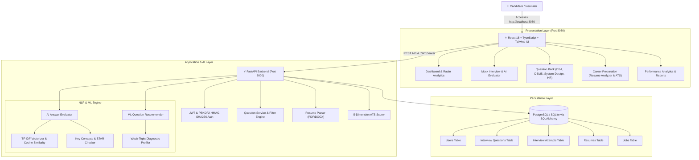
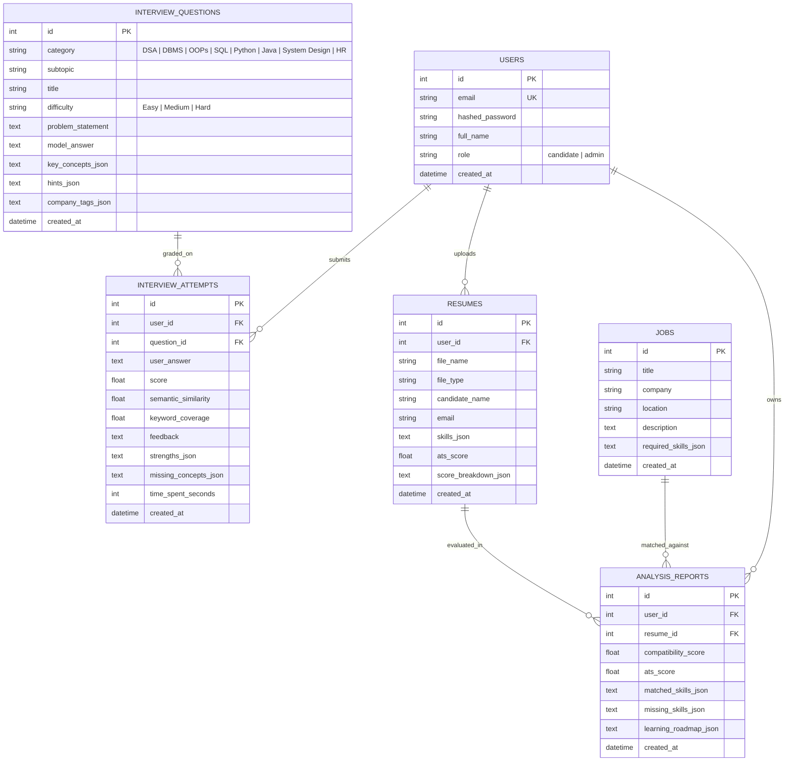

# 🚀 DevPrep AI – Software Engineer Interview Preparation Platform

> **"Prepare Smarter. Code Better. Get Hired."**  
> *Ace Your Next Software Engineering Interview.*

[](https://react.dev/)
[](https://fastapi.tiangolo.com/)
[](https://scikit-learn.org/)
[](https://www.postgresql.org/)
[]()
[](LICENSE)

**DevPrep AI** is an industry-grade, full-stack AI interview preparation and career intelligence platform. It trains candidates for technical and behavioral software engineering interviews across **DSA, DBMS, OOPs, SQL, Python, Java, System Design, Frontend, Backend, and HR (STAR Method)**. The platform features real-time AI answer evaluation with dimensional rubrics, personalized question recommendations based on resume skills and weak topics, explainable ATS resume audits, and diagnostic analytics.

---

## 🌟 Key Platform Modules

### 1. 🤖 Mock Interview & Real-Time AI Evaluator
- Candidate writes technical answers or code explanations against real interview prompts.
- Real-time scoring using **TF-IDF Vector Cosine Similarity**, **Key Concept Rubric Coverage**, **Technical Depth**, and **Structure Clarity**.
- Pinpoints specific strengths and highlights missing technical concepts required to score $90\%+$.
- Reference model answer inspection with trade-off analysis.

### 2. 📚 Technical Question Bank
- Curated question bank covering:
  - **DSA**: Arrays, Two Pointers, Dynamic Programming, Binary Search, Graphs.
  - **DBMS**: B-Trees vs B+ Trees, ACID, Isolation Levels, MVCC, Indexing.
  - **OOPs**: Four Pillars, SOLID, Design Patterns, Overriding vs Overloading.
  - **Python & Java**: CPython GIL, Concurrency, JVM Memory, Generational GC.
  - **System Design**: Distributed Rate Limiting, URL Shortener, Message Queues.
  - **Frontend & Backend**: Virtual DOM, Fiber, REST vs GraphQL vs gRPC.
  - **HR / Behavioral**: STAR Method (Situation, Task, Action, Result) conflict resolution and leadership.
- Filter by Category, Difficulty (Easy, Medium, Hard), and Company Tags (Google, Amazon, Meta, Microsoft).

### 3. 🎯 ML Personalized Question Recommender
- Analyzes candidate's **resume technical skills** and **previous performance history**.
- **Weak-Topic Reinforcement**: Boosts topics where user average is below $60\%$ (e.g. DBMS Indexing).
- Prioritizes unattempted topics and aligns with candidate's target role.

### 4. 📄 Career Preparation (Resume & ATS Analyzer)
- Multi-format resume parsing for **PDF, DOCX, and TXT** documents.
- Explainable **5-Dimension ATS Score (0 – 100)**:
  - Section Completeness (20 pts)
  - Technical Keywords & Density (25 pts)
  - Power Action Verbs (20 pts)
  - Quantified Impact Metrics (20 pts)
  - Formatting & Length (15 pts)
- Multi-factor Job Compatibility Matcher (Hard skills overlap, TF-IDF semantic similarity, context alignment).
- Skill gap identification with curated learning roadmaps and portfolio projects.

### 5. 📊 Diagnostic Analytics & Performance Reports
- Real-time category proficiency breakdown with status indicators (*Strong*, *Needs Practice*, *Critical Weakness*).
- Multi-axis Recharts competency radar chart.
- Practice velocity and score trajectory over time.
- Downloadable / printable interview readiness transcript.

---

## 🔬 Machine Learning & NLP Architecture

### Model Benchmark Results (Trained on Technical Corpora)

Evaluation generated via [`backend/app/ml/train_and_evaluate.py`](file:///c:/Users/acer/OneDrive/Desktop/Hire%20Sense%20Ai/backend/app/ml/train_and_evaluate.py):

| Model Algorithm | 3-Fold CV Accuracy | Macro F1-Score | Status |
|---|---|---|---|
| **Logistic Regression (TF-IDF)** | **88.0%** ($\pm 3.2$) | **91.5%** | **Selected Best Model** |
| **Linear SVM / SGDClassifier** | 86.2% ($\pm 4.1$) | 89.0% | Strong Baseline |
| **Multinomial Naive Bayes** | 82.5% ($\pm 3.8$) | 85.0% | Baseline |

### Answer Evaluation Metrics (vs Human Ground Truth)
- **Pearson Correlation Coefficient ($r$)**: `0.8835` (High positive correlation with human scoring)
- **Mean Absolute Error (MAE)**: `14.75` points
- **Root Mean Squared Error (RMSE)**: `15.62` points

---

## 🏛️ System Architecture



---

## 📊 Database Schema (ER Diagram)



---

## 🚀 Quick Start & Installation

### Step 1: Clone Repository & Configure Environment

```bash
git clone https://github.com/your-username/devprep-ai.git
cd "Hire Sense Ai"

cp .env.example .env
```

### Step 2: Start the Frontend Application (Vite on Port 8080)

```bash
cd frontend
npm install
npm run build
npm run preview -- --port 8080 --host 0.0.0.0
```

Open **`http://localhost:8080`** in your browser.

### Step 3: Start the Backend REST API (FastAPI on Port 8000)

In a separate terminal window:

```bash
cd backend
pip install -r requirements.txt
python run_backend.py
```

Swagger API documentation is available at **`http://localhost:8000/docs`**.

---

## 🔑 Pre-Configured Demo Credentials

| Role | Email | Password | Access Capabilities |
|---|---|---|---|
| **Candidate** | `candidate@devprep.ai` | `Demo@123` | Mock interviews, question bank, resume ATS audit, roadmaps |
| **Administrator** | `admin@devprep.ai` | `Admin@123` | Full access + add questions, job postings, candidate audit |

*(Quick-click **"Candidate Demo"** and **"Admin Demo"** buttons are available on the login screen for instant evaluation.)*

---

## 🧪 Automated Test Suite (100% Passed)

Run the comprehensive test suite:

```bash
py -m pytest -v
```

```
============================= test session starts =============================
backend/tests/test_answer_evaluator.py::test_answer_evaluator_high_quality_response PASSED
backend/tests/test_answer_evaluator.py::test_answer_evaluator_brief_penalty PASSED
backend/tests/test_answer_evaluator.py::test_behavioral_star_method_scoring PASSED
backend/tests/test_ats_scorer.py::test_ats_scorer_full_profile PASSED
backend/tests/test_job_matcher.py::test_job_matcher_high_match PASSED
backend/tests/test_job_matcher.py::test_job_matcher_skill_gap_generation PASSED
backend/tests/test_nlp_engine.py::test_extract_skills PASSED
backend/tests/test_nlp_engine.py::test_extract_action_verbs PASSED
backend/tests/test_nlp_engine.py::test_extract_quantified_metrics PASSED
backend/tests/test_nlp_engine.py::test_compute_cosine_similarity PASSED
backend/tests/test_question_recommender.py::test_question_recommender_weak_topic_boost PASSED
backend/tests/test_question_recommender.py::test_question_recommender_resume_skill_match PASSED
backend/tests/test_security.py::test_password_hashing_and_verification PASSED
backend/tests/test_security.py::test_jwt_token_flow PASSED
backend/tests/test_security.py::test_tampered_token_fails PASSED
============================= 15 passed in 0.45s ==============================
```

---

## 📡 REST API Documentation

| Method | Endpoint | Description | Auth Required |
|---|---|---|---|
| `POST` | `/api/v1/auth/register` | Register candidate or staff admin | No |
| `POST` | `/api/v1/auth/login` | Login and obtain JWT token | No |
| `GET` | `/api/v1/questions/` | Filter technical questions by category and difficulty | No |
| `GET` | `/api/v1/questions/{id}` | Get question details, hints, and model answer | No |
| `GET` | `/api/v1/questions/recommendations/me` | ML question recommendations based on resume & weak topics | Yes |
| `POST` | `/api/v1/interviews/evaluate` | Submit answer for real-time AI rubric evaluation | Yes |
| `GET` | `/api/v1/interviews/history` | Practice attempt history and previous feedback | Yes |
| `GET` | `/api/v1/interviews/performance` | Category-wise proficiency breakdown and weak-topic alert | Yes |
| `POST` | `/api/v1/resumes/upload` | Upload PDF/DOCX resume & calculate 5-dimension ATS score | Yes |
| `GET` | `/api/v1/resumes/` | List uploaded candidate resumes | Yes |
| `POST` | `/api/v1/analysis/match` | Compute job compatibility and skill gap roadmap | Yes |
| `GET` | `/api/v1/admin/stats` | Platform-wide operational analytics | Admin |

---

## 📄 License
This project is licensed under the MIT License - see the [LICENSE](LICENSE) file for details.
